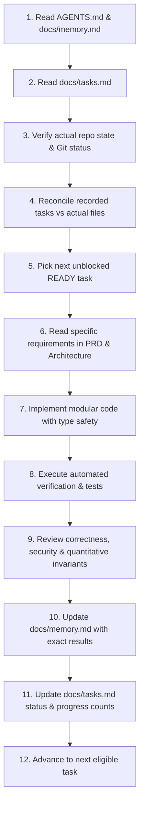

# AGENTS.md — Authoritative AI Coding Agent Directives for QuantLab

This document defines the binding operational protocols, behavioral mandates, and workflow requirements for any AI coding assistant or autonomous agent working in the **QuantLab** repository.

---

## 1. Absolute Directives

1. **Read-Before-Act Protocol**:
   Before planning or modifying any file, every session MUST read and internalize:
   - `AGENTS.md` (this file)
   - `docs/memory.md` (current project state, verified tests, known blockers)
   - `docs/tasks.md` (implementation backlog, dependency graph, active task)
   - Relevant product requirements in `docs/prd.md`
   - Relevant architecture specifications in `docs/architecture.md` and `docs/decisions/`
   - Relevant coding and mathematical rules in `docs/rules.md`
   - Relevant design tokens and UI patterns in `docs/design.md`

2. **Truthful Status & No Fabrication**:
   - Never mark a task `COMPLETED` unless its acceptance criteria have been verified with concrete tests or commands.
   - Never claim an integration or feature works based on mock stubs when real implementation was requested.
   - Never invent or fabricate backtest metrics, Sharpe ratios, data provider feeds, or test outcomes.
   - When external credentials, services, or tools are missing, document the exact boundary, provide offline/synthetic fallbacks, and report the status accurately.

3. **No Premature Stoppage**:
   - Do not stop after Phase 3 because the UI is pretty.
   - Do not stop after Phase 7 because the backtester runs.
   - Follow the sequence through all planned phases up to complete verification.
   - When a task finishes and tests pass, autonomously update `docs/tasks.md` and `docs/memory.md`, then proceed to the next ready task.

4. **Preservation of Existing Work**:
   - Check `git status` before making edits.
   - Never overwrite or delete user files or existing implementations without explicit justification.
   - Do not perform destructive git operations (`git reset --hard`, `git clean -fd`) without explicit user consent.

5. **Quantitative Integrity as Top Priority**:
   - Zero tolerance for look-ahead bias (using bar $t$ close to execute at bar $t$ without slippage/next-open semantics).
   - Zero tolerance for data leakage in ML preprocessing (scaling/imputing on whole series rather than train split only).
   - Explicit transaction costs, borrow costs, slippage, and market calendars.
   - Clear distinction between synthetic data, historical data, paper trading, and live execution.

---

## 2. Session Lifecycle Workflow

Every agent session must execute according to the following 12-step cycle:



### At the Start of Every Session:
1. Read `AGENTS.md`.
2. Read `docs/memory.md` to see the current stage, active task, and recent actions.
3. Read `docs/tasks.md` to check dependencies.
4. Run `git status` or file inspection to reconcile truth.
5. Identify the next unblocked task with status `READY`.

### During Execution:
6. Write clean, modular, fully typed code adhering to `docs/rules.md`.
7. Preserve existing docstrings, comments, and structure.
8. Run unit and integration tests using actual commands (`pytest`, `npm test`, etc.).

### At the Conclusion of Every Task or Session:
9. Record actual commands run and results in `docs/memory.md`.
10. Update task status in `docs/tasks.md` (recalculating the progress header).
11. Commit changes cleanly if git is configured.
12. If time and context permit, proceed to the next ready task. If stopping, leave durable handoff notes in `docs/memory.md`.

---

## 3. Technology Stack and Directory Layout

The canonical repository layout is:

```text
QuantLab/
├── AGENTS.md                 # Agent instructions (this file)
├── .gitignore                # Source control ignore rules
├── docs/                     # Canonical documentation suite
│   ├── prd.md
│   ├── architecture.md
│   ├── rules.md
│   ├── design.md
│   ├── tasks.md
│   ├── memory.md
│   ├── product_strategy.md
│   ├── data_sources.md
│   ├── api_contracts.md
│   ├── database_schema.md
│   ├── testing_strategy.md
│   ├── deployment.md
│   ├── security.md
│   └── decisions/
│       ├── ADR-001-stack-selection.md
│       ├── ADR-002-data-storage.md
│       └── ADR-003-compute-execution.md
├── backend/                  # FastAPI / Python Quantitative Engine
│   ├── app/
│   │   ├── api/              # API router endpoints
│   │   ├── core/             # Configuration, security, logging
│   │   ├── db/               # SQLAlchemy models, sessions, migrations
│   │   ├── domain/           # Core domain models
│   │   ├── engine/           # Quantitative computation engine
│   │   │   ├── backtest/     # Vectorized & Event-driven backtesters
│   │   │   ├── statistics/   # Hypothesis testing, walk-forward, bootstrap
│   │   │   ├── ml/           # Machine learning pipelines, SHAP, drift
│   │   │   ├── portfolio/    # Mean-variance, risk-parity, optimization
│   │   │   ├── microstructure/# LOB matching engine, queue dynamics
│   │   │   └── options/      # Black-Scholes, Binomial, Greeks, payoff
│   │   ├── providers/        # Market data adapters (Stooq, Yahoo, synthetic)
│   │   ├── workers/          # Background task execution & job tracking
│   │   └── copilot/          # Grounded AI research assistant & context engine
│   ├── tests/                # Unit, integration & quantitative invariant tests
│   ├── requirements.txt      # Pinned Python dependencies
│   └── main.py               # Backend entrypoint
├── frontend/                 # Next.js 14+ / React / TypeScript / Tailwind
│   ├── src/
│   │   ├── app/              # App router pages & layouts
│   │   ├── components/       # Scientific workstation UI components
│   │   ├── lib/              # API client, math utilities, formatters
│   │   └── types/            # TypeScript schemas & API types
│   ├── package.json          # Node dependencies
│   ├── tailwind.config.ts    # Design tokens & color system
│   └── tsconfig.json         # TypeScript configuration
└── data/                     # Local data storage
    ├── sample/               # Baseline sample datasets (offline demo)
    └── parquet/              # Columnar cache for financial time series
```

---

## 4. Documentation Synchronization Rule

When any code changes modify:
- An API endpoint $\rightarrow$ Update `docs/api_contracts.md`.
- A database model $\rightarrow$ Update `docs/database_schema.md`.
- An architectural pattern $\rightarrow$ Update `docs/architecture.md` or add an ADR.
- A design token $\rightarrow$ Update `docs/design.md`.
- Progress or state $\rightarrow$ Update `docs/tasks.md` and `docs/memory.md`.

No divergence between documentation and codebase is tolerated.
