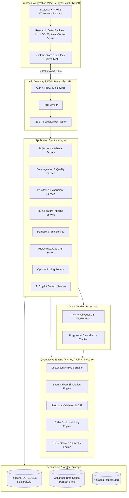
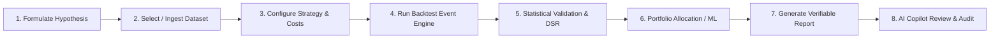
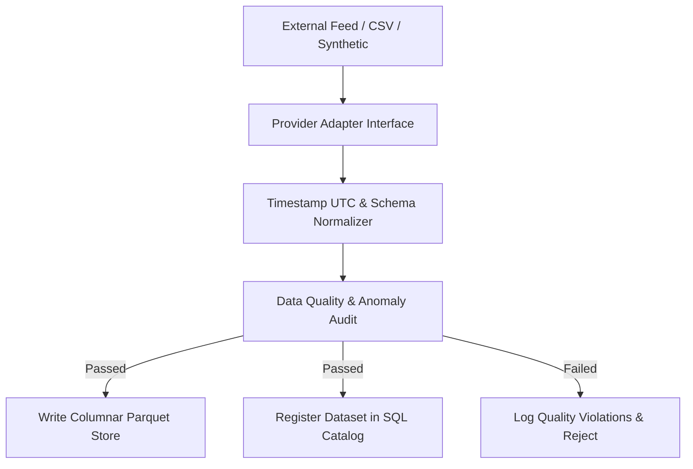
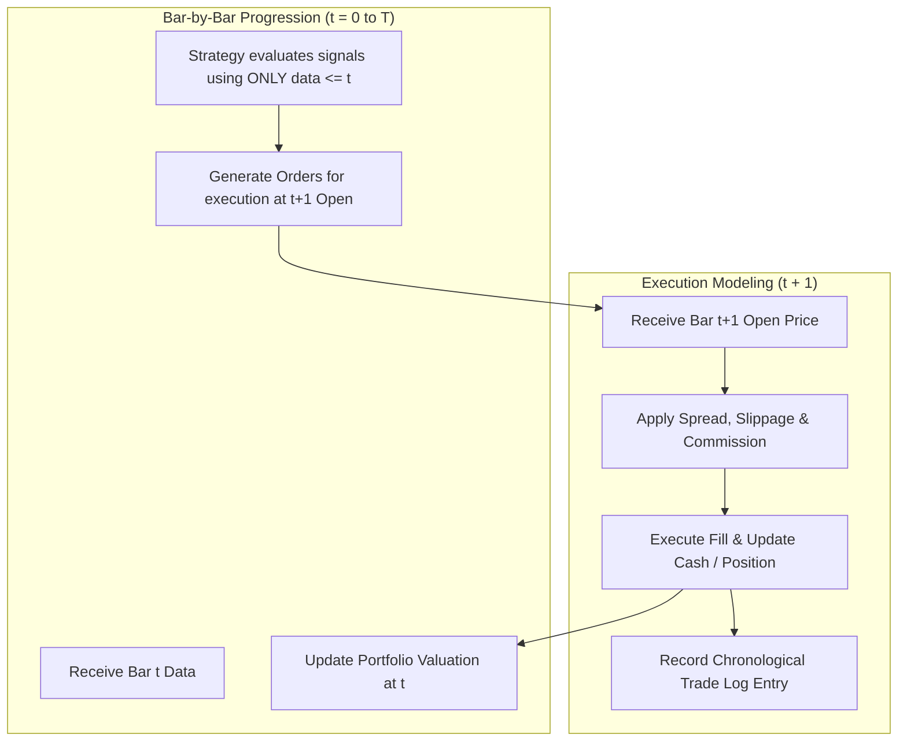
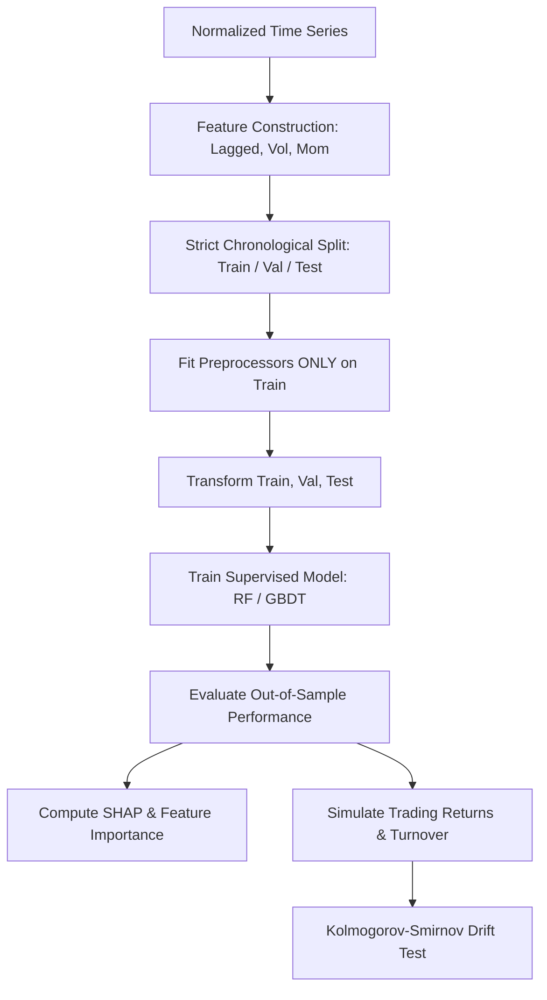
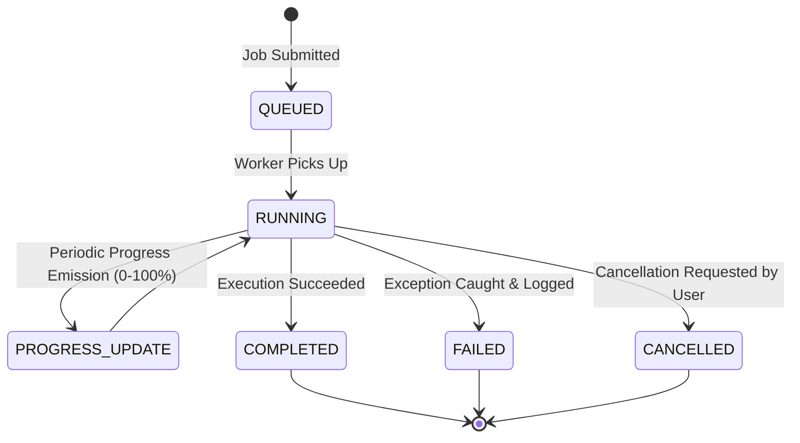
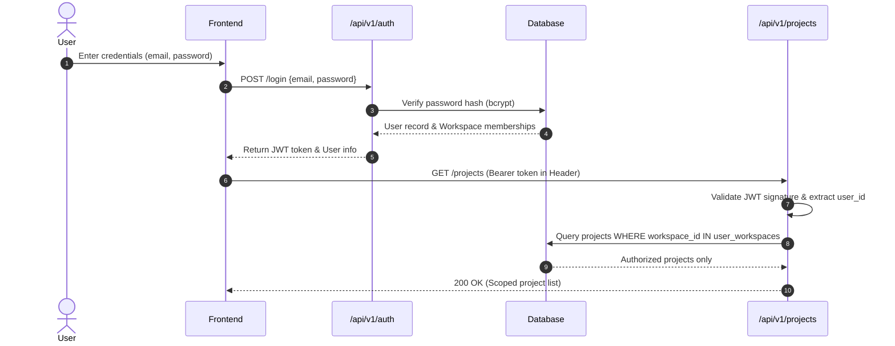
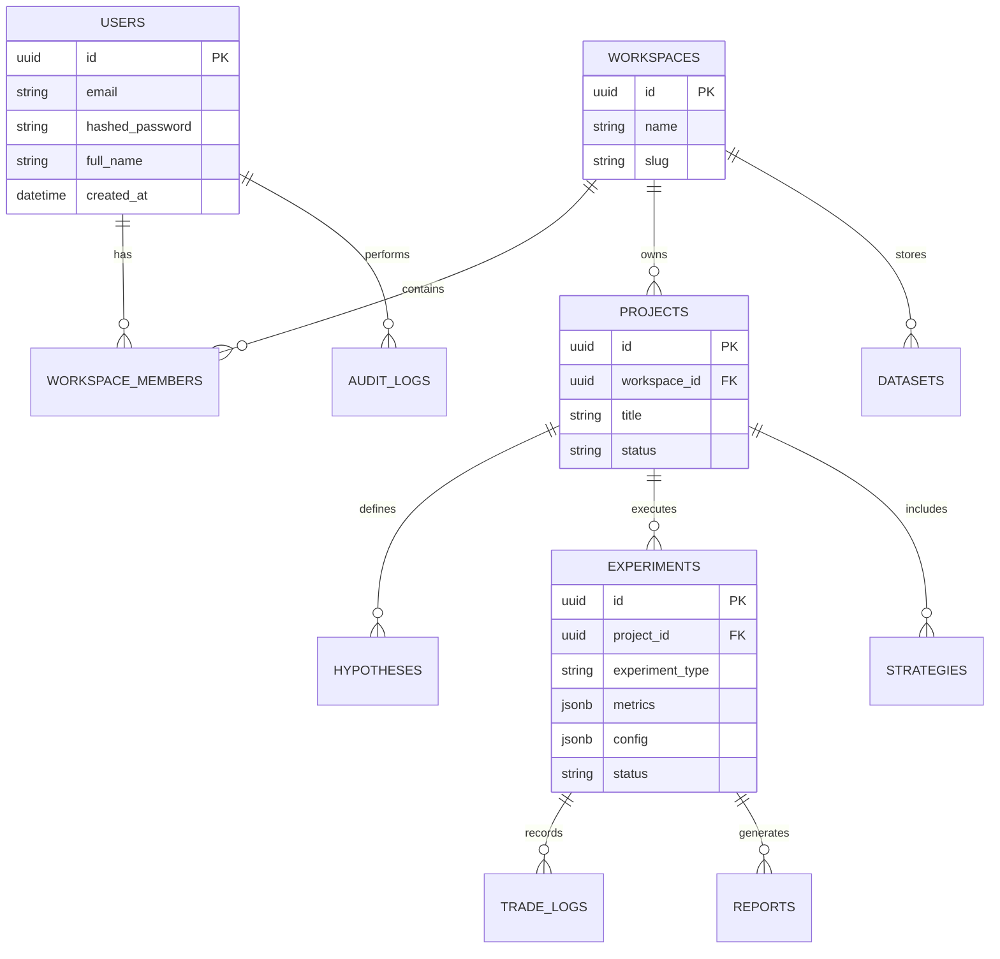
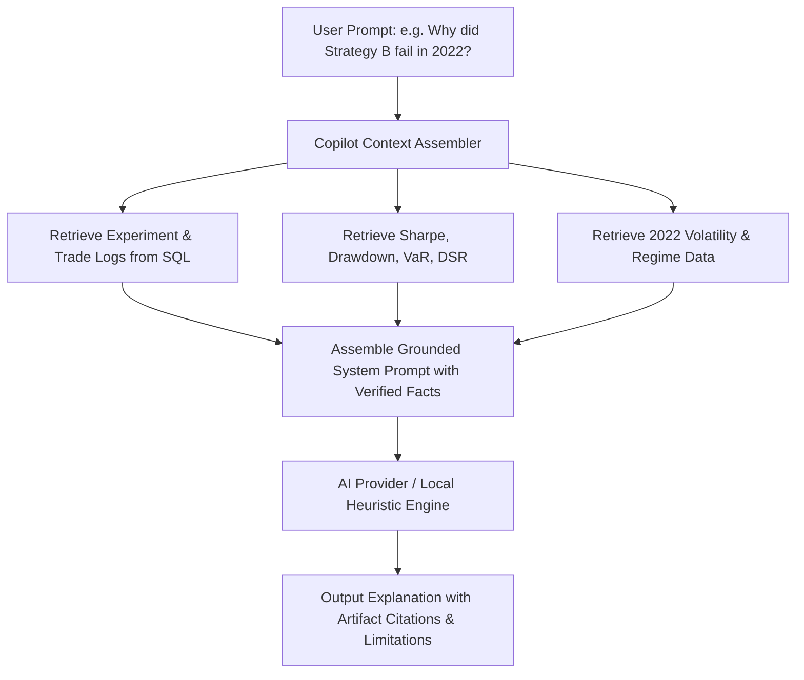

# QuantLab System Architecture Specification

**Document Version:** 1.0.0  
**Status:** Approved for Implementation  
**Classification:** Core System Architecture  

---

## 1. System Overview & Technology Stack

QuantLab adopts a clean, decoupled architecture:
- **Frontend Layer**: Next.js 14+ (App Router), React, TypeScript, Tailwind CSS, Lucide icons, Financial Charting components. Designed as a high-density, institutional-grade quantitative workstation.
- **API & Application Layer**: FastAPI (Python 3.13), Pydantic v2 schemas, Dependency Injection, Starlette middleware, JWT authentication.
- **Domain & Quantitative Engine Layer**: Pure Python, NumPy, pandas, SciPy, statsmodels, scikit-learn. Vectorized matrix operations for fast screening; event-driven state-machine for realistic microstructure and execution simulation.
- **Persistence & Storage Layer**:
  - Relational Metadata: PostgreSQL in production; SQLite for zero-config local development and testing, unified via SQLAlchemy 2.0 ORM and Alembic migrations.
  - Time-Series Storage: High-performance columnar Apache Parquet files organized by dataset ID, instrument, and resolution.
- **Execution & Background Worker Layer**: Async worker queue with job lifecycle management, live progress reporting, cancellation, and execution isolation.

---

## 2. Mermaid Diagrams Suite

### 2.1 Diagram 1: Overall System Architecture



---

### 2.2 Diagram 2: Research Execution Flow



---

### 2.3 Diagram 3: Market Data Ingestion & Normalization



---

### 2.4 Diagram 4: Backtesting Engine Architecture



---

### 2.5 Diagram 5: Machine Learning Experimentation Pipeline



---

### 2.6 Diagram 6: Background Job Lifecycle



---

### 2.7 Diagram 7: Authentication & Access Control



---

### 2.8 Diagram 8: Core Relational Database Entities



---

### 2.9 Diagram 9: AI Copilot Grounded Context Flow



---

### 2.10 Diagram 10: Deployment Architecture

```mermaid
flowchart TB
    subgraph Host["Host Environment (Native or Containerized)"]
        subgraph WebTier["Frontend Tier (Port 3000)"]
            NextServer[Next.js App Server (Node.js 26)]
        end
        subgraph APITier["Backend Tier (Port 8000)"]
            FastAPIServer[Uvicorn / FastAPI API (Python 3.13)]
            AsyncWorkerPool[Background Job Worker Pool]
        end
        subgraph DataTier["Storage Tier"]
            SQLiteDB[(SQLite / PostgreSQL Database)]
            ParquetVolume[(Local Parquet Filesystem: ./data/parquet)]
        end
    end
    ClientBrowser[User Web Browser] <==> NextServer
    NextServer <==>|Reverse Proxy / Internal HTTP| FastAPIServer
    FastAPIServer --> AsyncWorkerPool
    FastAPIServer --> SQLiteDB
    FastAPIServer --> ParquetVolume
    AsyncWorkerPool --> ParquetVolume
```

---

## 3. Subsystem Breakdown & Architectural Decisions

### 3.1 Quantitative Engine Design
The quantitative engine is strictly decoupled from web protocols. All math algorithms accept standard NumPy arrays, pandas DataFrames, or pure Python primitives and return structured dictionary/Pydantic models.
- **Vectorized Module (`engine/backtest/vectorized.py`)**: Uses matrix operations for ultra-fast signal evaluation, indicator calculation (RSI, SMA, EMA, MACD, Bollinger), and rapid preliminary performance ranking.
- **Event-Driven Module (`engine/backtest/event.py`)**: Models discrete time transitions. Manages Portfolio, Position, and Order state machines. Computes cash flows, commissions, slippage, and borrow financing bar-by-bar.
- **Microstructure Module (`engine/microstructure/lob.py`)**: In-memory double auction order book. Maintains Bid and Ask heaps/price levels with queue FIFO tracking.
- **Options Pricing Module (`engine/options/pricer.py`)**: Exact Black-Scholes analytical formulas, Greeks derivation, CRR binomial tree for American options, and numerical implied volatility solvers.

### 3.2 Persistent Data Management
1. **Application State**: Handled via SQLAlchemy 2.0 with asynchronous and synchronous sessions. Migrations handled by Alembic.
2. **Financial Time-Series**: Stored in columnar Apache Parquet. Parquet provides 10x-50x compression, zero-copy reads via pyarrow, and eliminates database bloat from storing millions of tick/bar records in relational rows.
