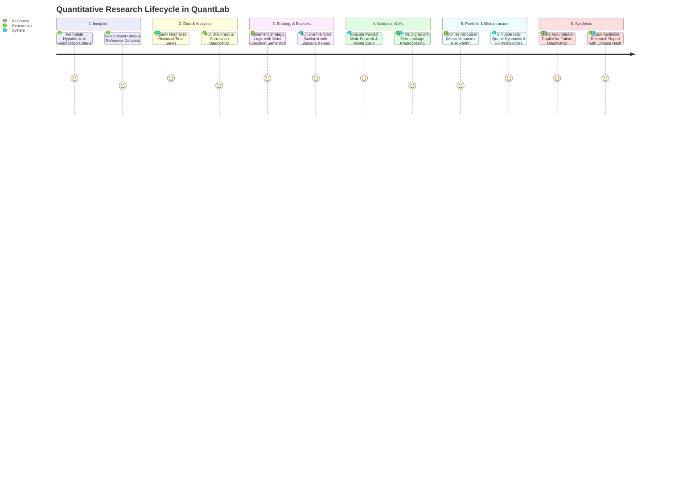

# QuantLab Product Requirements Document (PRD)

**Document Version:** 1.0.0  
**Status:** Approved for Implementation  
**Classification:** Core System Specification  

---

## 1. Vision & Problem Statement

### 1.1 Vision
QuantLab is a unified, scientifically rigorous quantitative research and experimentation platform that guides a quantitative researcher seamlessly through the entire research lifecycle:
$$\text{Hypothesis} \longrightarrow \text{Data} \longrightarrow \text{Exploration} \longrightarrow \text{Strategy} \longrightarrow \text{Backtest} \longrightarrow \text{Validation} \longrightarrow \text{ML / Portfolio} \longrightarrow \text{Paper Trading} \longrightarrow \text{Report}$$

### 1.2 Problem Statement
Quantitative research today is crippled by fragmented tooling:
1. **Unchecked Look-Ahead Bias & P-Hacking**: Standard backtesting scripts frequently use $t$-close prices to trade at $t$-close without accounting for execution delay, or fit normalizers across the whole historical series.
2. **Disconnected Toolchains**: Data ingestion, notebook prototyping, backtesting libraries, ML frameworks, and portfolio optimizers live in disparate scripts with no unified lineage.
3. **Ignoring Failures**: Researchers delete losing backtests, leading to severe multiple-testing bias and false discoveries.
4. **Unrealistic Execution Modeling**: Most backtesting frameworks treat execution as frictionless fills at historical bar prices, ignoring limit order queue dynamics, order book depth, and market impact.
5. **Hallucinatory AI Assistants**: Generic LLMs hallucinate financial metrics and strategy code without access to verified calculation engines or historical data artifacts.

QuantLab solves these problems by providing an integrated, production-grade workstation that enforces quantitative invariants, tracks all experiments, models market microstructure, and grounds AI assistance in verifiable system artifacts.

---

## 2. User Personas

1. **Dr. Elena Vance (Senior Quantitative Researcher)**:
   Needs rigorous statistical validation, purged walk-forward cross-validation, deflated Sharpe ratios, and reproducible experiment lineage for factor investing.
2. **Marcus Chen (Algorithmic Trader & Quant Developer)**:
   Focuses on execution latency, order book dynamics, slippage models, transaction cost attribution, and paper trading transitions.
3. **Priya Sharma (Financial Machine Learning Engineer)**:
   Trains gradient boosting and time-series models on financial features, requiring strict chronological data partitions, SHAP interpretability, and concept drift diagnostics.
4. **Alex Rivera (Master's Student in Financial Engineering)**:
   Needs clear mathematical explanations, educational baseline strategies (MA crossover, momentum, mean reversion), and guided walkthroughs of common research pitfalls.

---

## 3. Core User Journeys

---

## 4. Complete Module Inventory

1. **Authentication & RBAC (`MOD-AUTH`)**: User accounts, JWT sessions, workspaces, project permissions.
2. **Research Projects & Hypotheses (`MOD-PROJ`)**: Projects, hypotheses, falsification criteria, research notes.
3. **Market Data Infrastructure (`MOD-DATA`)**: Ingestion, normalization, caching, quality checks, synthetic generator.
4. **Exploratory Data Analytics (`MOD-EDA`)**: Returns, rolling volatility, drawdowns, autocorrelation, stationarity.
5. **Strategy Engine (`MOD-STRAT`)**: Declarative and programmatic strategy specifications, parameter sweeps.
6. **Backtesting Engine (`MOD-BT`)**: Vectorized and event-driven simulation, non-negotiable time semantics, cost models.
7. **Performance & Risk Metrics (`MOD-METRIC`)**: Sharpe, Sortino, Calmar, MaxDD, VaR, CVaR, turnover, exposure.
8. **Statistical Validation Lab (`MOD-VAL`)**: Walk-forward, purged K-fold, bootstrap CI, Deflated Sharpe Ratio.
9. **Machine Learning Lab (`MOD-ML`)**: Time-aware feature pipelines, scikit-learn/XGBoost, SHAP, calibration, drift.
10. **Portfolio Construction (`MOD-PORT`)**: Mean-variance, risk parity, inverse-volatility, rebalancing constraints.
11. **Risk Management (`MOD-RISK`)**: Exposure limits, sector concentration, scenario stress testing, VaR limits.
12. **Market Microstructure & LOB Simulator (`MOD-LOB`)**: Limit order book matching engine, queue dynamics, Hawkes flow.
13. **Options & Derivatives Lab (`MOD-OPT`)**: Black-Scholes, Binomial tree, Greeks, volatility smile, payoff diagrams.
14. **AI Research Copilot (`MOD-AI`)**: Artifact-grounded research assistant, methodology review, report writer.
15. **Experiment Tracking & Lineage (`MOD-EXP`)**: Immutable experiment records, dependency hashing, comparison views.
16. **Paper Trading Engine (`MOD-PAPER`)**: Real-time simulated execution, order state lifecycle, virtual broker.
17. **Reporting & Collaboration (`MOD-REP`)**: PDF/JSON/CSV research tearsheet generation, comments, audit trails.
18. **Observability & Worker Monitor (`MOD-OBS`)**: Background job status, worker health, logs, resource monitoring.

---

## 5. Functional Requirements Specification

### Module 1: Authentication, Workspaces, and RBAC
- **REQ-AUTH-001**: System shall provide secure user registration, email/password authentication, and JWT session handling.
- **REQ-AUTH-002**: System shall support Personal and Team Workspaces with Role-Based Access Control (`Viewer`, `Researcher`, `Admin`).
- **REQ-AUTH-003**: System shall strictly isolate workspace resources at the database query level; no user may read or modify another workspace's project or dataset without authorization.
- **REQ-AUTH-004**: System shall record audit logs for all security-sensitive actions (password changes, role updates, project deletion).

### Module 2: Research Projects & Hypothesis Management
- **REQ-PROJ-001**: User shall be able to create research projects containing: Title, Description, Asset Class, Objectives, Formal Hypotheses, Underlying Market Mechanism, Predicted Outcome, and Falsification Criteria.
- **REQ-PROJ-002**: System shall track project status (`Draft`, `In Progress`, `Validated`, `Rejected`, `Archived`).
- **REQ-PROJ-003**: System shall treat rejected/failed hypotheses and unprofitable backtests as permanent first-class records to prevent publication bias.
- **REQ-PROJ-004**: System shall support rich Markdown research notes attached to projects and experiments.

### Module 3: Market Data Infrastructure
- **REQ-DATA-001**: System shall provide a provider-agnostic data ingestion architecture supporting equities, ETFs, crypto, and macroeconomic series.
- **REQ-DATA-002**: System shall include working adapters for publicly accessible data (Stooq, Yahoo Finance fallback) and a built-in deterministic synthetic market data generator for offline testing.
- **REQ-DATA-003**: System shall normalize all incoming time series into standardized OHLCV schemas with explicit UTC timestamps, frequency intervals, and split/dividend adjustments.
- **REQ-DATA-004**: System shall execute automated Data Quality Audits on import, checking for: missing bars, negative prices, price jumps ($>50\%$), volume anomalies, and duplicate timestamps.
- **REQ-DATA-005**: System shall store normalized time series in columnar Parquet format for high-throughput reads, maintaining a metadata catalog in PostgreSQL/SQLite.

### Module 4: Exploratory Data Analytics
- **REQ-EDA-001**: System shall compute and visualize simple returns, logarithmic returns, rolling volatility (annualized), rolling beta, and drawdown series.
- **REQ-EDA-002**: System shall compute statistical distribution metrics: Mean, Standard Deviation, Skewness, Kurtosis, Jarque-Bera normality test, and Augmented Dickey-Fuller (ADF) stationarity test.
- **REQ-EDA-003**: System shall compute autocorrelation (ACF), partial autocorrelation (PACF), and pairwise correlation matrices across selected instruments.
- **REQ-EDA-004**: System shall provide interactive financial charting with pan, zoom, crosshair, volume subplots, and responsive layout.

### Module 5 & 6: Strategy Framework & Backtesting Engine
- **REQ-STRAT-001**: System shall provide reusable strategy base classes with standard lifecycle methods: `initialize()`, `on_bar()`, `generate_signals()`, and `get_target_weights()`.
- **REQ-STRAT-002**: System shall provide built-in baseline strategies labeled as educational: Buy & Hold, Moving Average Crossover (SMA/EMA), Momentum (Cross-Sectional & Time-Series), and Mean Reversion (Bollinger/RSI).
- **REQ-BT-001 (Time Semantics)**: The backtesting engine must strictly enforce that decisions made at bar $t$ (using bar $t$ data) execute at bar $t+1$ Open (or bar $t$ Close with explicit execution latency penalty). Same-bar look-ahead execution is strictly prohibited.
- **REQ-BT-002**: Engine shall support configurable execution models: fixed spread, proportional commission (bps or per-share), percentage slippage, and borrow financing rates for short positions.
- **REQ-BT-003**: Engine shall track cash balance, gross exposure, net exposure, positions (long/short), unrealized PnL, realized PnL, and transaction cost deductions at every timestep.
- **REQ-BT-004**: Engine shall output complete chronological trade logs, order logs, cash histories, and equity curves.

### Module 7: Performance & Risk Metrics
- **REQ-METRIC-001**: System shall compute standard risk-adjusted return metrics: Total Return, CAGR, Annualized Volatility, Sharpe Ratio ($r_f$ configurable), Sortino Ratio, Calmar Ratio, Max Drawdown, and Max Drawdown Duration.
- **REQ-METRIC-002**: System shall compute trade-level metrics: Total Trades, Win Rate, Profit Factor, Average Win / Loss Ratio, Expectancy, and Average Holding Period.
- **REQ-METRIC-003**: System shall compute tail risk metrics: Historical Value-at-Risk (VaR at 95% and 99%) and Conditional Value-at-Risk (CVaR / Expected Shortfall).
- **REQ-METRIC-004**: System shall display explicit warnings if data frequency is insufficient for reliable annualization or if volatility is zero.

### Module 8: Statistical Validation Laboratory
- **REQ-VAL-001**: System shall implement chronological train-validation-test data partitioning, strictly prohibiting random shuffling on time-series data.
- **REQ-VAL-002**: System shall support Walk-Forward Analysis with rolling and expanding training windows and out-of-sample test windows.
- **REQ-VAL-003**: System shall implement Purged K-Fold Cross-Validation with configurable embargo periods to eliminate autocorrelation overlap between train and test folds.
- **REQ-VAL-004**: System shall compute Bootstrap Confidence Intervals (stationary block bootstrap) for Sharpe ratio and mean returns.
- **REQ-VAL-005**: System shall compute the Deflated Sharpe Ratio (DSR) to account for multiple testing and track the number of strategy trials evaluated.
- **REQ-VAL-006**: System shall run parameter sensitivity sweeps and transaction cost stress tests (varying slippage by $2\times, 5\times, 10\times$).

### Module 9: Machine Learning Research Laboratory
- **REQ-ML-001**: System shall provide feature engineering tools (lagged returns, rolling momentum, volatility, RSI, MACD, z-scores) with strict prevention of look-ahead leakage (transformations fit only on training sets).
- **REQ-ML-002**: System shall support supervised models: Ridge/Lasso Regression, Logistic Regression, Random Forest, and Gradient Boosting (XGBoost / HistGradientBoosting).
- **REQ-ML-003**: System shall evaluate model predictions using classification metrics (Accuracy, ROC-AUC, Brier score) or regression metrics (MSE, MAE, Information Coefficient) AND economic trading performance after costs.
- **REQ-ML-004**: System shall provide feature importance analysis and SHAP summary plots.
- **REQ-ML-005**: System shall provide concept drift detection comparing train vs. test feature distributions (Kolmogorov-Smirnov test).

### Module 10: Portfolio Construction & Optimization
- **REQ-PORT-001**: System shall support Equal Weight, Inverse Volatility, and Hierarchical/Equal Risk Parity allocation methods.
- **REQ-PORT-002**: System shall implement Markowitz Mean-Variance Optimization: Maximum Sharpe Ratio, Minimum Volatility, and Target Return portfolios.
- **REQ-PORT-003**: System shall support covariance estimation options: Sample Covariance, Ledoit-Wolf Shrinkage, and Exponentially Weighted Covariance.
- **REQ-PORT-004**: System shall enforce constraints: Long-only ($w_i \ge 0$), Max Position Weight ($w_i \le w_{\max}$), and Gross Exposure Target ($\sum |w_i| = 1.0$).
- **REQ-PORT-005**: If the optimization problem is infeasible or non-convergent, the system shall fail gracefully with explicit diagnostics rather than outputting invalid weights.

### Module 11: Risk Management Engine
- **REQ-RISK-001**: System shall monitor portfolio risk budgets: maximum drawdown threshold, maximum leverage, and single-asset concentration limits.
- **REQ-RISK-002**: System shall execute Historical Scenario Stress Tests (e.g., 2008 Financial Crisis, 2020 Flash Crash, custom shock curves).
- **REQ-RISK-003**: System shall calculate marginal risk contribution ($MRC_i$) and percentage contribution to risk ($PCR_i$) for each asset in a portfolio.

### Module 12: Limit Order Book (LOB) & Market Microstructure
- **REQ-LOB-001**: System shall implement an in-memory Limit Order Book supporting price-time priority matching for Bid and Ask sides with customizable tick size.
- **REQ-LOB-002**: Engine shall handle Limit Orders, Market Orders, Order Cancellations, and Partial Fills.
- **REQ-LOB-003**: Simulator shall model queue position for resting limit orders (fill occurs only after prior queue depth at price level is depleted).
- **REQ-LOB-004**: System shall compute microstructure metrics: Bid-Ask Spread, Midprice, Microprice (volume-weighted midprice), Order Book Depth, and Order Flow Imbalance (OFI).
- **REQ-LOB-005**: System shall provide synthetic order flow generators (Poisson arrival / Hawkes process) and visual LOB ladder rendering.

### Module 13: Options & Derivatives Laboratory
- **REQ-OPT-001**: System shall implement analytical Black-Scholes-Merton pricing for European Call and Put options.
- **REQ-OPT-002**: System shall compute analytical first and second-order Greeks: Delta, Gamma, Theta, Vega, and Rho.
- **REQ-OPT-003**: System shall implement Cox-Ross-Rubinstein (CRR) Binomial Tree pricing for American options with early exercise.
- **REQ-OPT-004**: System shall calculate Implied Volatility via Newton-Raphson / Brent root finding.
- **REQ-OPT-005**: System shall visualize multi-leg option strategy payoff diagrams (Straddle, Strangle, Bull Call Spread, Iron Condor).

### Module 14: Grounded AI Research Copilot
- **REQ-AI-001**: AI Copilot shall ground all responses in verified system artifacts (project hypotheses, dataset summaries, backtest trade logs, validation metrics).
- **REQ-AI-002**: Copilot shall support methodology reviews, explaining why a strategy failed, identifying potential look-ahead leakage, and suggesting out-of-sample robustness checks.
- **REQ-AI-003**: Copilot shall cite specific experiment IDs and metric values; it is strictly prohibited from fabricating backtests or citing unverified returns.
- **REQ-AI-004**: If no external AI provider API key is configured, the Copilot shall operate in a graceful local deterministic mode (heuristic research advice & rule-based auditing).

### Module 15: Experiment Tracking & Lineage
- **REQ-EXP-001**: Every backtest, ML run, and optimization shall produce an immutable Experiment entity with a unique ID, timestamp, user, configuration, dataset hash, code version, and metrics.
- **REQ-EXP-002**: System shall provide an interactive Experiment Comparison Matrix allowing side-by-side metric comparison, equity curve overlay, and parameter diffing.

### Module 16: Paper Trading Simulator
- **REQ-PAPER-001**: System shall provide a virtual paper trading environment with simulated capital accounts, live order book tracking, and fill execution.
- **REQ-PAPER-002**: Paper trading orders shall undergo pre-trade risk checks (buying power, position limits, leverage limits) before acceptance.
- **REQ-PAPER-003**: System shall maintain live paper trading positions, open orders, trade executions, and realized/unrealized PnL.

### Module 17: Reports & Exports
- **REQ-REP-001**: System shall generate comprehensive Research Tearsheets containing: hypothesis summary, dataset provenance, backtest metrics, equity curves, drawdown analysis, robustness tests, and known limitations.
- **REQ-REP-002**: System shall export complete data packages: JSON experiment metadata, CSV trade logs, and printable HTML/PDF research reports.

### Module 18: Operational Observability & Job Management
- **REQ-OBS-001**: System shall provide a centralized Background Job Manager supporting job queuing, real-time progress percentages, cancellation, failure logs, and retries.
- **REQ-OBS-002**: System shall expose `/health` and `/metrics` endpoints reporting worker status, database connectivity, and memory usage.

---

## 6. Non-Functional Requirements

- **NFR-PERF-001**: Vectorized backtest on 10 years of daily data ($2,520$ bars) across 10 instruments shall execute in under 2.0 seconds.
- **NFR-PERF-002**: API responses for cached data and experiment metadata shall return within 150 ms ($p95$).
- **NFR-SEC-001**: Passwords must be hashed using bcrypt or Argon2 with high work factor.
- **NFR-SEC-002**: All strategy parameters and user inputs must be strictly validated using Pydantic schemas. User-supplied strategy code must not have arbitrary host filesystem or network access.
- **NFR-ACC-001**: UI shall comply with WCAG 2.1 AA contrast standards and support full keyboard navigation.
- **NFR-REL-001**: Zero crash policy on invalid numerical inputs (e.g. division by zero in Sharpe calculation must return `0.0` or `null` with explicit warning flag).
