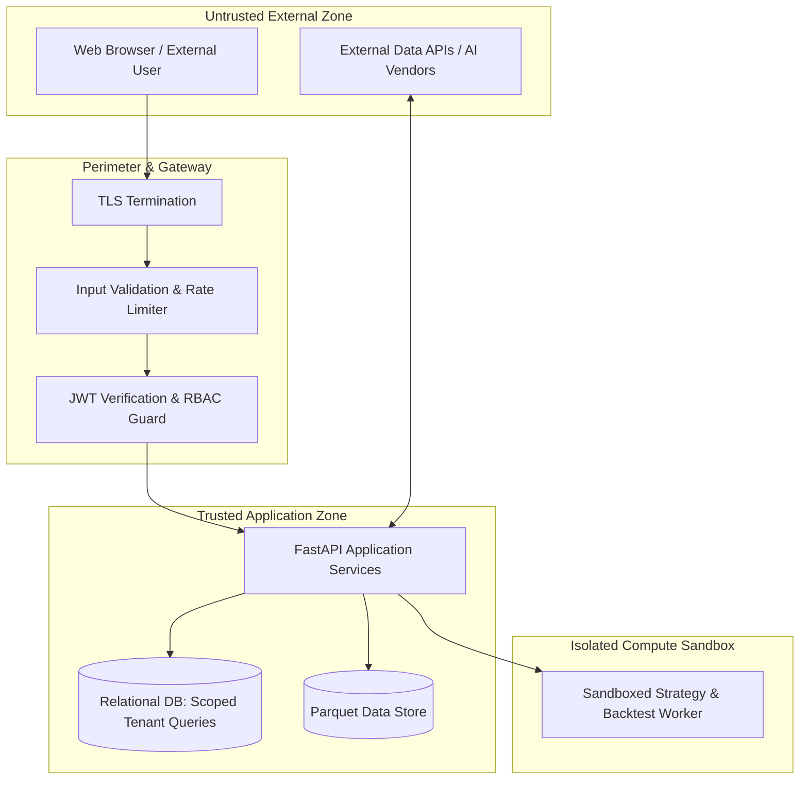

# QuantLab Security Architecture & Threat Model

**Document Version:** 1.0.0  
**Status:** Approved for Implementation  
**Classification:** Security Mandate & Policy  

---

## 1. Threat Model & Trust Boundaries

QuantLab processes sensitive financial strategies, proprietary research models, and credentials. The security architecture identifies four primary trust boundaries:

---

## 2. Core Security Controls

### 2.1 Multi-Tenant Workspace Isolation
- Every relational query accessing projects, hypotheses, datasets, strategies, or experiments must include the active workspace filter (`WHERE workspace_id = :active_workspace_id`).
- Insecure Direct Object References (IDOR) are prevented by verifying that the requesting user possesses valid membership in the target workspace prior to resolving any UUID.

### 2.2 Strategy Execution Sandboxing
- Under no circumstances shall arbitrary Python code supplied by a user or generated by the AI copilot be passed to `eval()`, `exec()`, or a shell command within the web process.
- Strategies are defined through declarative parameter schemas and validated domain classes.
- If user code compilation is enabled, it must run inside an isolated subprocess with restricted system calls, restricted memory, and disabled network access.

### 2.3 Protection of Secrets & API Keys
- No secrets shall ever be committed to git or exposed to the client bundle (`NEXT_PUBLIC_` prefixes are strictly prohibited for secrets).
- External provider keys (Alpha Vantage, OpenAI, Anthropic) are loaded exclusively via server-side environment variables.

### 2.4 Cryptographic Standards
- User passwords are encrypted with bcrypt using a minimum work factor of 12.
- Session tokens are stateless HMAC-SHA256 JWTs with a maximum expiration of 24 hours.
- Sensitive state hashes (experiment lineage) utilize SHA-256.

### 2.5 Input Sanitization & Attack Mitigation
- SQL Injection: Mitigated by 100% parameterized queries via SQLAlchemy 2.0 ORM.
- Cross-Site Scripting (XSS): Mitigated by React's automatic string escaping and DOMPurify on Markdown rendered notes.
- Cross-Origin Resource Sharing (CORS): Whitelisted strictly to approved frontend origins.
- Rate Limiting: Sensitive endpoints (`/auth/login`, `/copilot/chat`) are rate-limited to prevent brute-force attacks and denial-of-service.
