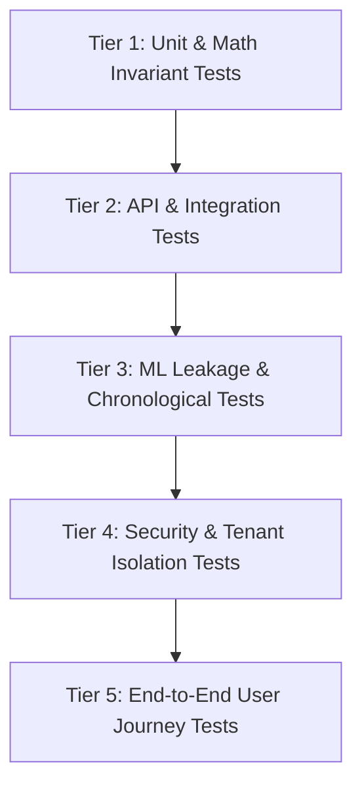

# QuantLab Comprehensive Testing Strategy & Verification Gates

**Document Version:** 1.0.0  
**Status:** Approved for Implementation  
**Classification:** Quality Assurance & Verification Mandate  

---

## 1. Testing Hierarchy & Verification Framework

QuantLab implements a rigorous multi-tier testing framework designed to prevent regressions and verify both software functionality and mathematical correctness.

---

## 2. Quantitative Invariants Test Suite

Every release and continuous integration pipeline must execute mathematical invariant tests that verify fundamental laws of finance and statistics.

### Invariant 1: Put-Call Parity in Options Pricing
For European options under Black-Scholes assumptions with dividend yield $q=0$:
$$C(S, K, T) - P(S, K, T) = S - K e^{-r T}$$
*Test verification*: Evaluate across 1,000 randomized parameter tuples ($S \in [10, 500]$, $K \in [10, 500]$, $T \in [0.01, 3.0]$, $\sigma \in [0.05, 1.5]$, $r \in [0.001, 0.15]$). Absolute difference $|(C - P) - (S - K e^{-rT})|$ must not exceed $10^{-6}$.

### Invariant 2: Greeks Finite Difference Convergence
Verify analytical Greeks against central finite difference approximations:
$$\text{Delta} \approx \frac{V(S + \epsilon) - V(S - \epsilon)}{2 \epsilon}, \quad \text{Gamma} \approx \frac{V(S + \epsilon) - 2V(S) + V(S - \epsilon)}{\epsilon^2}$$
*Test verification*: Relative error must be $< 0.01\%$ for $\epsilon = 10^{-4}$.

### Invariant 3: Portfolio Cash & NAV Conservation
At every step $t$ in the backtesting simulation:
$$\text{NAV}_t = \text{Cash}_t + \sum_{i} \text{Shares}_{i,t} \times \text{Price}_{i,t}$$
$$\text{Total Realized PnL} = \sum (\text{Gross PnL}) - \sum (\text{Commissions}) - \sum (\text{Borrow Fees})$$
*Test verification*: Invariant must hold within floating point tolerance ($10^{-8}$) across all trades.

### Invariant 4: No Look-Ahead Bias Invariant
- Test that executing a strategy on prices where future data has been deliberately altered after bar $t$ produces **identical** orders at bar $t$.
- Specifically, inject an extreme price shock ($+500\%$) into bar $t+10$. The strategy's decision and trade log at bar $t \le 9$ must remain bit-for-bit identical to the unshocked baseline.

### Invariant 5: Strict ML Preprocessing Isolation
- Verify that fitting standard scalers (e.g. `StandardScaler`) or imputers on the full dataset yields different parameters than fitting on $D_{\text{train}}$ only.
- Assert that QuantLab's feature pipeline applies `scaler.fit(D_train)` and only `scaler.transform(D_test)`.

### Invariant 6: Limit Order Book Conservation
- At every order book event (insertion, cancellation, execution), total outstanding units on the book must satisfy:
  $$\text{Units}_{\text{post}} = \text{Units}_{\text{pre}} + \text{Inserted} - \text{Cancelled} - \text{Filled}$$
  Negative queue depths or negative bid-ask spreads are strictly impossible.

---

## 3. Test Layers & Execution Commands

### 3.1 Backend Tests (`backend/tests/`)
- Run all tests: `python -m pytest backend/tests -v`
- Unit tests only: `python -m pytest backend/tests/unit -v`
- Integration tests only: `python -m pytest backend/tests/integration -v`
- Quantitative invariants only: `python -m pytest backend/tests/unit/test_invariants.py -v`

### 3.2 Frontend Tests (`frontend/`)
- Run component & unit tests: `npm test`
- Type checking: `npm run type-check` (or `npx tsc --noEmit`)
- Linting: `npm run lint`

---

## 4. Acceptance Gate Checklist

A task or milestone is only accepted when:
1. All relevant unit tests pass with zero failures.
2. Type checking returns zero errors.
3. Automated quantitative invariants pass.
4. Changes are recorded in `docs/memory.md` with exact command output.
5. Backlog task status is updated in `docs/tasks.md`.
